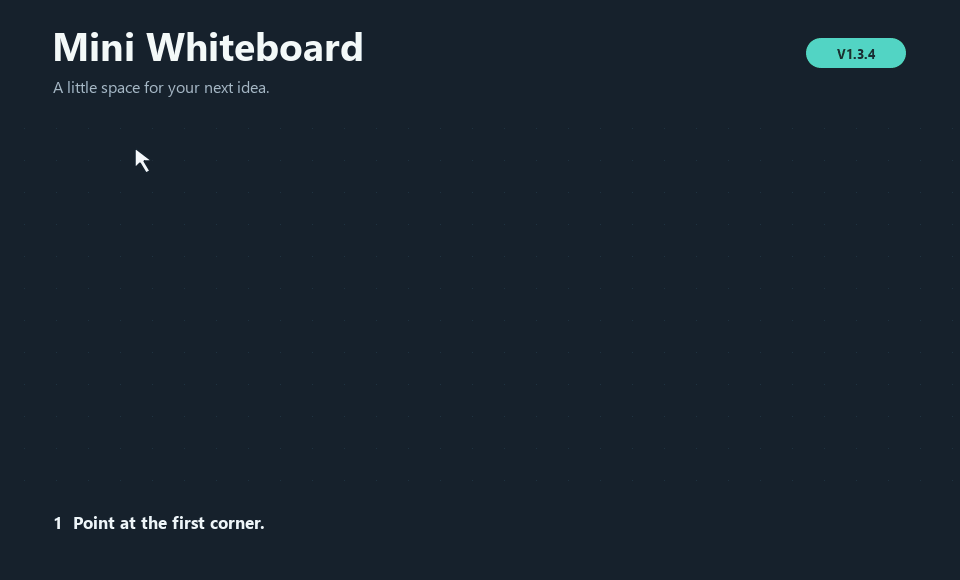
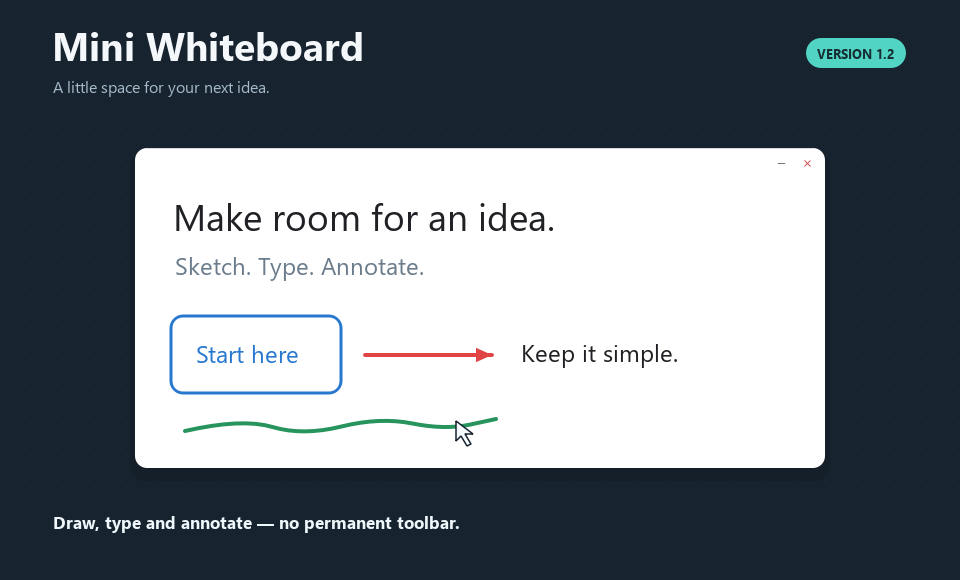

# Mini Whiteboard

Place a small desktop whiteboard by holding a shortcut, moving the pointer and
releasing. Draw, type, paste images and annotate screenshots without a permanent
toolbar. Launch opens only a Windows tray icon or a macOS menu-bar item.

## Download V1.2.1

| Download | Platform | Installation |
|---|---|---|
| [Windows ZIP](https://github.com/nottbradd/MiniWhiteboard/releases/download/v1.2.1/WinMiniWhiteboardV1.2.1.zip) | Windows 10/11, x64 | Extract the ZIP, open **Mini Whiteboard**, run **Mini Whiteboard.exe**. Keep the entire folder together. |
| [Mac preview ZIP](https://github.com/nottbradd/MiniWhiteboard/releases/download/v1.2.1/MacMiniWhiteboardV1.2.1-Preview.zip) | macOS 14+; preview | Extract on a Mac, move **Mini Whiteboard.app** to Applications and open it. |

Python and Qt are included. [Release notes and verification](docs/RELEASE_NOTES.md)
describe this patch. [Checksums and dependency sources](https://github.com/nottbradd/MiniWhiteboard/releases/tag/v1.2.1)
accompany the downloads.

Windows is unsigned. The Mac preview is ad-hoc signed and has not been notarized.
For a trusted Mac download blocked by Gatekeeper, follow
[Apple's Open Anyway instructions](https://support.apple.com/en-au/102445).
Interactive Mac acceptance, execution on macOS 14 and Intel hardware remain
**NOT RUN**. Universal2 bundle checks and limited startup do not establish those results.

The demo uses the app controller and renderer on a controlled desktop.

A board with drawing, shapes and text

## Place a board or screenshot

1. Point at the first corner and hold **Ctrl+Alt+W** on Windows or
   **Control+Option+W** on Mac.
2. Keep holding and move to the opposite corner. Dots preview the rectangle.
3. Release W **or any required modifier** to create a focused board.

Use **S** in the same global shortcut to capture a region into a new board
with a locked screenshot background, ready to annotate. Mac's **Global shortcuts**
menu also offers **Command+Option+Shift+W/S** when the default conflicts.

Both gestures support four directions and negative desktop coordinates. A board
below 160 × 100 logical pixels, or a capture below 4 × 4 desktop units, cancels.
Escape or the tray/menu cancellation clears a preview. Held repeats cannot
create more boards. Screen capture may request Screen Recording permission on
Mac; a denied or failed capture creates no board.

## Tools and shortcuts

Tools work only in the focused canvas. New boards start in Draw mode.
Press **F1** for the compact shortcut reference.

| Key | Action |
|---|---|
| D, then 1–5 | Draw at 2, 4, 6, 9 or 14 logical px |
| T, then 1–3 | Text at 14, 20 or 28 pt; apply to selected text or the next textbox |
| S, then 1–7 | Rectangle, rounded rectangle, ellipse, line, arrow, triangle, diamond |
| A or V | Select and transform; Shift-click toggles, Shift-marquee adds fully enclosed objects |
| E, then 1–4 | Partial circular eraser at 8, 16, 32 or 64 logical px |
| E, then 5 | Toggle whole-stroke erasing; toggling off returns to circular 16 px |
| C | Temporary colour palette; 1–7 choose presets |
| Arrows / Shift+arrows | Move selection by 1 / 10 logical px |
| Delete / Backspace | Delete selected editable objects |
| Escape | Cancel a gesture or clear selection |

| Action | Windows | Mac |
|---|---|---|
| Copy / cut / paste / duplicate | Ctrl+C / X / V / D | Command+C / X / V / D |
| Select all | Ctrl+A | Command+A |
| Undo / redo | Ctrl+Z / Ctrl+Shift+Z or Ctrl+Y | Command+Z / Command+Shift+Z |
| Bypass snapping | Alt | Option |
| Finish text | Ctrl+Enter or Escape | Command+Return or Escape |

Text wraps to a stored width. Enter adds a newline; the temporary editor follows
the caret for tall content. Resizing the board preserves objects and text width.
While editing, letters, numbers, clipboard commands, arrows, deletion and undo
belong exclusively to the text editor.

Clicking outside blank or whitespace-only text dismisses it without starting a
canvas action. A separate next click immediately creates text. Meaningful text
keeps its whitespace; in Text mode an outside click can commit it and start or
edit the next textbox. Clearing existing text removes it with one board undo.

Selection has shared move, resize and rotation controls. Corners preserve ratio;
edges scale one axis unless Shift is held or the group contains text or images.
Shift snaps rotation to 15°. Shape creation retains square/circle constraints.
Circular erasure cuts every editable object under its swept brush. Whole-stroke
erasure removes an original freehand gesture, including its surviving fragments.
Masks follow objects through transforms and edits.

Right-click for ordering and lock/unlock commands. Paste images or drop local
PNG, JPEG and WEBP files. **Snap & Guides** controls Smart Guides and Grid Snap.
The minus button hides a board while preserving contents and history; the red
× deletes that board. The tray/menu restores boards. Closing the last board
leaves the utility running; choose **Exit/Quit Mini Whiteboard** to end the session.

## Limitations and development

- Documents are session-only. Only preferences are saved.
- Windows 11 has scripted native and packaged checks. Windows 10, clean-machine
  deployment and physical mixed-DPI arrangements still need testing.
- Mac remains a preview. Interactive shortcuts, focus, permissions, capture,
  Spaces and Retina/multi-monitor acceptance are outstanding. Floating windows
  use normal Space membership; coverage over every full-screen app is not guaranteed.
- Linux is unsupported. Images are limited to 64 million pixels and editable
  clipboard data to 96 MB. Protected desktop content may be unavailable to capture.
- The app has no accounts, network service or telemetry.

[CONTRIBUTING](CONTRIBUTING.md) covers source setup, architecture and rebuilding.
[Testing and troubleshooting](docs/TESTING.md) covers native checks and remaining
hardware acceptance. [Report a bug](https://github.com/nottbradd/MiniWhiteboard/issues)
with the version, OS and reproduction steps.

## License

Mini Whiteboard's own source and assets use the [MIT license](LICENSE).
Dependencies retain their own terms; see [third-party notices](docs/THIRD_PARTY_NOTICES.md).
Both packages contain license texts, exact dependency versions, notice hashes
and the [source/rebuild guide](assets/licenses/SOURCES.md).
