# Mini Whiteboard

Place a small desktop whiteboard by holding a shortcut, moving the pointer and
releasing. Draw, type, paste images and annotate screenshots with keyboard shortcuts or optional floating tools. Launch opens only a Windows tray icon or a macOS menu-bar item.

**[V1.3.6 is the current official Windows release](https://github.com/nottbradd/MiniWhiteboard/releases/tag/v1.3.6).**
It adds optional compact floating tools and reduces repeated geometry work during
freehand drawing. Mac remains **Universal2 Preview**. Known visual and testing
limitations are described below and in the release notes.

Windows defaults are **Ctrl+Win+Shift+W** (board) and **Ctrl+Win+Shift+Q**
(screenshot). Mac remains **Universal2 Preview**.

## Download V1.3.6

| Download | Platform | Installation |
|---|---|---|
| [Windows installer — recommended](https://github.com/nottbradd/MiniWhiteboard/releases/download/v1.3.6/MiniWhiteboard-1.3.6-Setup.exe) | Windows 10/11, x64 | Close Mini Whiteboard and run Setup. Installs for your account or replaces the registered installed copy. |
| [Windows portable ZIP](https://github.com/nottbradd/MiniWhiteboard/releases/download/v1.3.6/WinMiniWhiteboardV1.3.6.zip) | Windows 10/11, x64 | Extract the ZIP, open **Mini Whiteboard**, run **Mini Whiteboard.exe**. When updating, close the old copy and replace its complete application folder manually. |
| [Mac Universal2 Preview ZIP](https://github.com/nottbradd/MiniWhiteboard/releases/download/v1.3.6/MacMiniWhiteboardV1.3.6-Preview.zip) | macOS 14+; arm64 and x86_64 bundle | Quit, extract on a Mac and replace **Mini Whiteboard.app** in Applications. Interactive Mac acceptance is **NOT RUN**. |

Python and Qt are included. [Release notes and verification](docs/RELEASE_NOTES.md#v136--windows-release--mac-universal2-preview--14-november-2026),
[SHA-256 checksums](https://github.com/nottbradd/MiniWhiteboard/releases/download/v1.3.6/SHA256SUMS.txt)
and [dependency sources](assets/licenses/SOURCES.md) accompany the release.
These are the unchanged review-02 packages from source `b4b9d27`, previously
published as [v1.3.6-early.1](https://github.com/nottbradd/MiniWhiteboard/releases/tag/v1.3.6-early.1).
That prerelease, [V1.3.4 HotkeyPatch](https://github.com/nottbradd/MiniWhiteboard/releases/tag/v1.3.4)
and [historical releases](https://github.com/nottbradd/MiniWhiteboard/releases) remain available.

Existing saved hotkeys stay as chosen; use **Settings → Hotkeys → Reset Defaults → Apply**
to select **Ctrl+Win+Shift+W/Q**. Enable **Settings → Show floating tools** from the
tray/menu bar. Tap a tool, hold or right-click for options, and drag the dotted grip.
The toolbar starts off and follows the active board when enabled.

**White remains the default appearance.** The published V1.3.6 Glass finish appeared grey on the tested hosted
Windows 11 ARM64 client under x64 emulation with Hyper-V graphics and Test Mode,
and on the Server test desktop. Its cause remains unresolved; **Appearance → White**
provides the verified opaque appearance. One editable-clipboard case and complete
client tray/settings and HotkeyPatch upgrade/rollback/reinstall/uninstall acceptance
remain unresolved. These limitations are retained in the official release; see the
[verification details](docs/RELEASE_NOTES.md#v136--windows-release--mac-universal2-preview--14-november-2026).

Microsoft's completed written response reported no positive scanner or telemetry
indicators for the submitted V1.3.6 EXE. Its portal file-level determination still
displayed **Pending** on 14 November 2026; this is not a definitive **Not malware**
classification. The original reported quarantine remains unexplained. See
[security troubleshooting](docs/TESTING.md#security-reports-and-release-acceptance).

Windows is unsigned. The Mac preview is ad-hoc signed and has not been notarized.
For a trusted Mac download blocked by Gatekeeper, follow
[Apple's Open Anyway instructions](https://support.apple.com/en-au/102445).
Interactive Mac acceptance, execution on macOS 14 and Intel hardware remain
**NOT RUN**. Universal2 bundle checks and limited startup do not establish those results.

### Installation and Open at login

The **Windows installer is recommended**. It installs for your
account without an administrator prompt, adds Mini Whiteboard to Start/Search,
and offers a desktop shortcut. The portable ZIP remains available: extract it
and keep its entire folder together. Both launch quietly into the tray.

On Mac, extract the **Universal2 Preview ZIP** on a Mac and move Mini Whiteboard.app
to Applications. Interactive Mac acceptance is **NOT RUN**.

Choose **Open at login** in the tray/menu-bar menu to opt in. It is off by
default. The app reads the OS registration each time the menu opens. If Windows
Startup apps or macOS Login Items blocks it, follow the shown settings action;
the app does not silently enable it again. Choose **Turn off Open at login** to
remove the app's registration while startup is disabled or approval is pending.
Keep portable copies in a permanent folder before enabling startup.
Development and temporary copies cannot register.
Startup registration and controlled command launches were tested. Automatic
launch during an actual Windows sign-in is **NOT RUN (not tested)**.

To upgrade an installed Windows copy, keep any work you need, choose **Exit Mini
Whiteboard**, then **run the newer installer**. It replaces the existing installation
in place under the same app identity; downloading alone does not update it. Setup
checks the replacement and backs up replaced files before copying. It removes
obsolete payload files only when ownership and their original hashes match.
Preferences, custom hotkeys and the Open at login choice remain. Setup and
uninstall refuse to proceed while the app is running.

For the portable ZIP, close the old copy, extract the new ZIP and replace its
application folder as a whole. The installer does not search for or delete portable
copies or historical downloads. On Mac, quit and replace **Mini Whiteboard.app**
in **Applications**. Uninstall removes its own shortcuts and login registration;
preferences remain for a later reinstall.

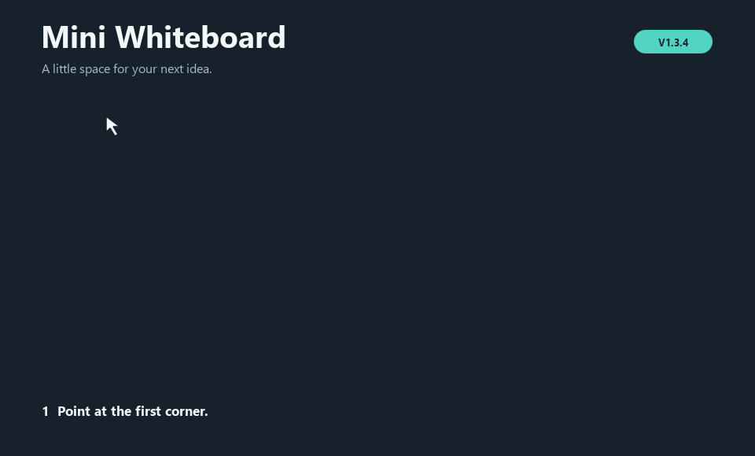

The demo uses the app controller and renderer on a controlled desktop.

A board with drawing, shapes and text

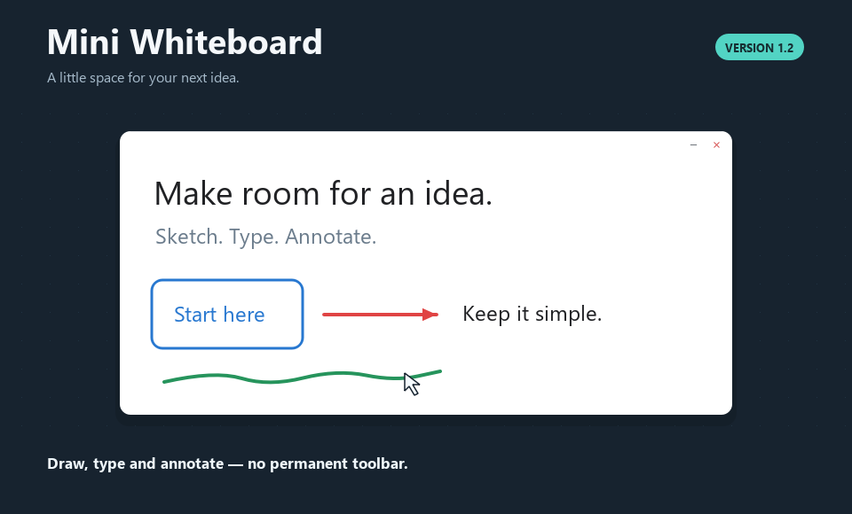

## Place a board or screenshot

1. Point at the first corner and hold **Ctrl+Win+Shift+W** on Windows or
   **Control+Option+W** on Mac.
2. Keep holding and move to the opposite corner. A temporary outline previews the rectangle.
3. Release the trigger key **or any required modifier** to create a focused board.

Use **Q** on Windows or **S** on Mac in the same global shortcut to capture a region into a new board
with a locked screenshot background, ready to annotate. Mac's **Global shortcuts**
menu also offers **Command+Option+Shift+W/S/H** when the default conflicts.

Both gestures support four directions and negative desktop coordinates. A board
below 160 × 100 logical pixels, or a capture below 4 × 4 desktop units, cancels.
Escape or the tray/menu cancellation clears a preview. Held repeats cannot
create more boards. Screen capture may request Screen Recording permission on
Mac; a denied or failed capture creates no board.

Windows screenshot creation defaults to **Ctrl+Win+Shift+Q**. Both left/right modifier
keys work. Open **tray → Settings → Hotkeys** to record a chord or select modifiers
and a key manually. Create, capture and Hide All can use different chords. Apply
checks duplicates and OS registration before saving; Cancel keeps the previous
configuration. Reset Defaults changes the editor until you choose Apply.

If a shortcut is already owned, its tray entry says **unavailable** and opens
Hotkeys settings. Other actions remain registered. Select the explicit
**Win+Alt+Shift+W/Q compatibility preset**, or choose another available chord.
The app never takes over another owner's shortcut or silently changes defaults.
Global actions pause while Hotkeys settings is open. Explicit choices survive
restart and upgrade; existing Hide All and Mac preset choices are retained.
Windows reserves Ctrl+Esc and Ctrl+Shift+Esc. For a custom creation chord whose
Escape combination is unavailable, the app reports it and offers tray-menu
cancellation; choose a different chord for keyboard cancellation.

Hotkey settings

Record or select each shortcut, then choose Apply. Opening Settings pauses global
actions while the configuration is edited. This example shows custom bindings.

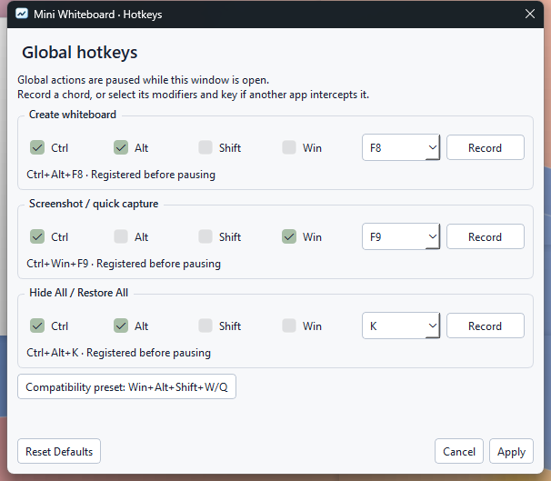

Screenshot content reaches the rounded board boundary. Small translucent controls
and temporary feedback sit over the image; copied image content excludes them.
The top edge still moves the window and its edges/corners resize it.

## Optional floating tools (V1.3.6)

Enable **tray/menu bar → Settings → Show floating tools**. This preference is
remembered and starts off. One compact palette follows the active board; other
applications keep their focus. Each board keeps its own tool, colour and sizes.

Tap Draw, Eraser, Select, Shape or Text. Hold a tool, or right-click it, for its
options. Colour and Undo/Redo are directly available. Drag the dotted grip to
move the palette. It starts above the board, moves below when the top is full,
and sits inside when neither outside position fits. Narrow screens wrap its
42-pixel targets; making the board bigger does not enlarge the controls.

The palette and options stay out of document exports and screenshot backgrounds.
Selecting a tool finishes the current textbox; ordinary tool keys still type
normally inside the text editor. Real stylus and physical mixed-DPI acceptance
remain **NOT RUN**.

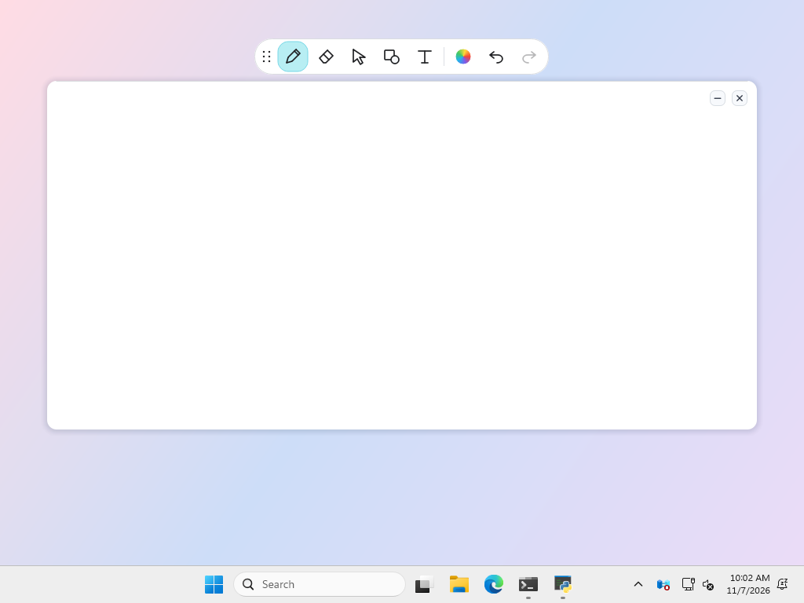

Actual V1.3.6 application capture on the Windows Server 2025 test desktop.
The pastel background is a separate demonstration window. The palette is
375 × 46 logical pixels with 20-pixel icons and 42-pixel tool targets.

Placement, customisation and small-board examples

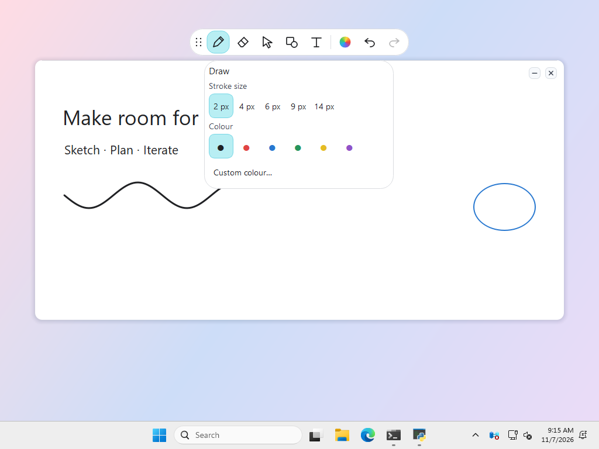

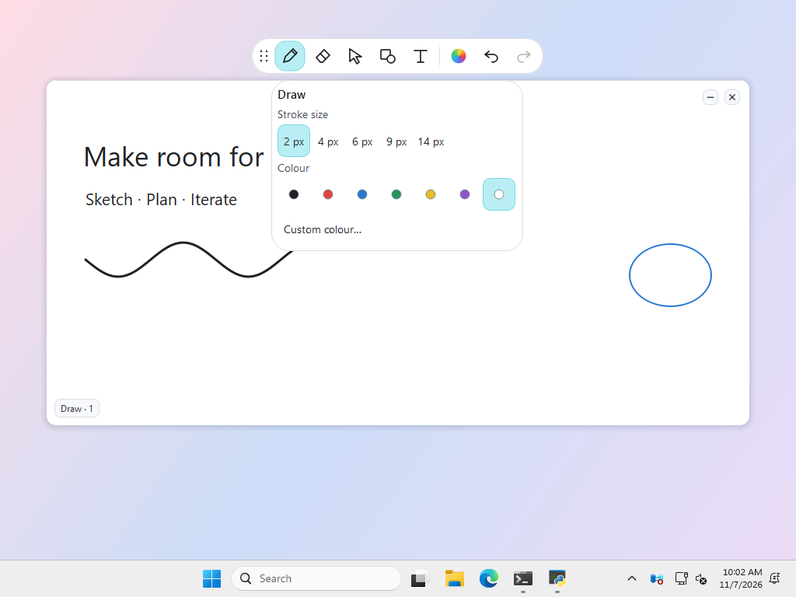

Swatches retain their fill colour inside a subtle outline. The options title uses
compact semibold text.

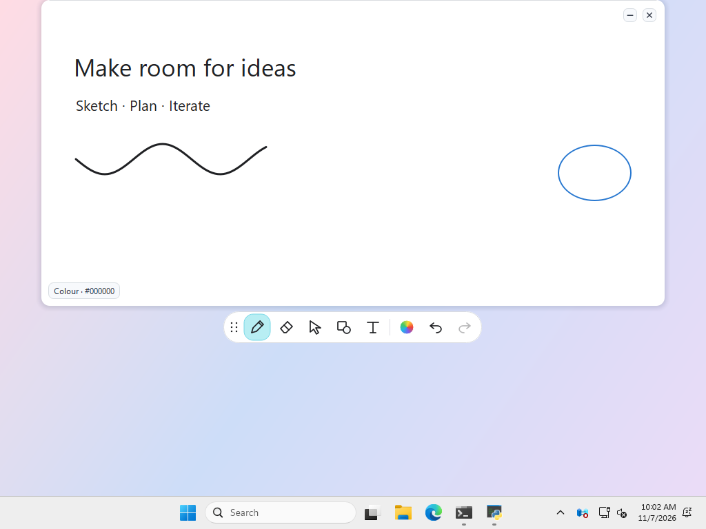

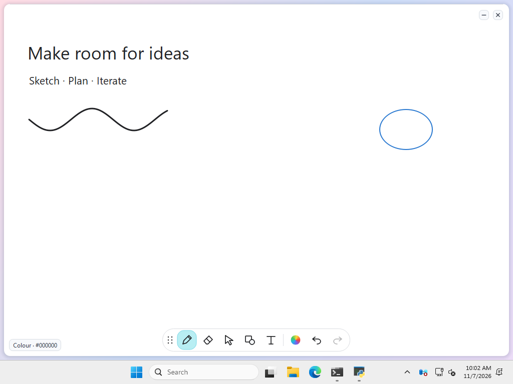

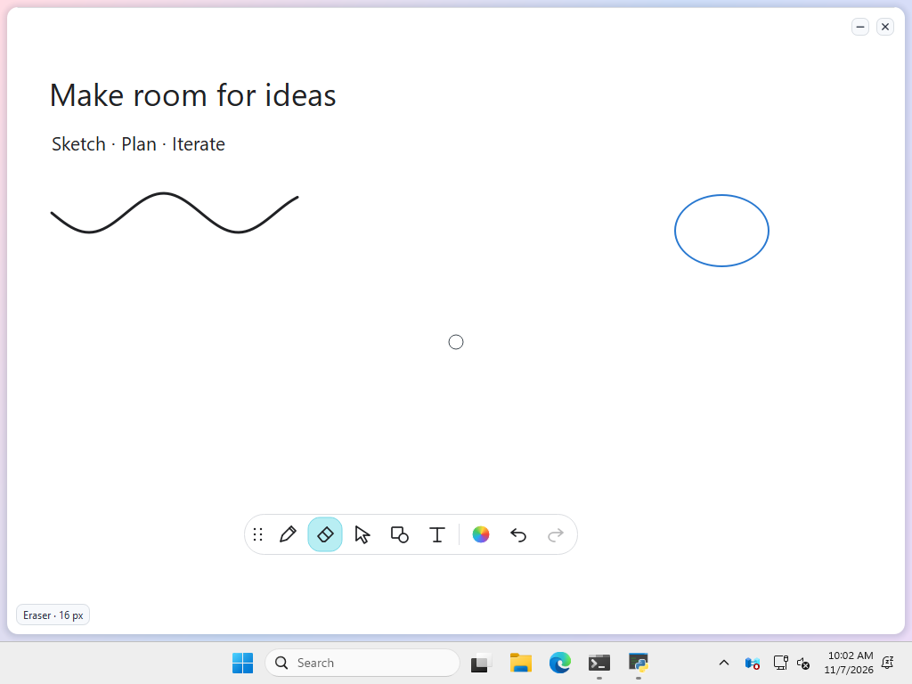

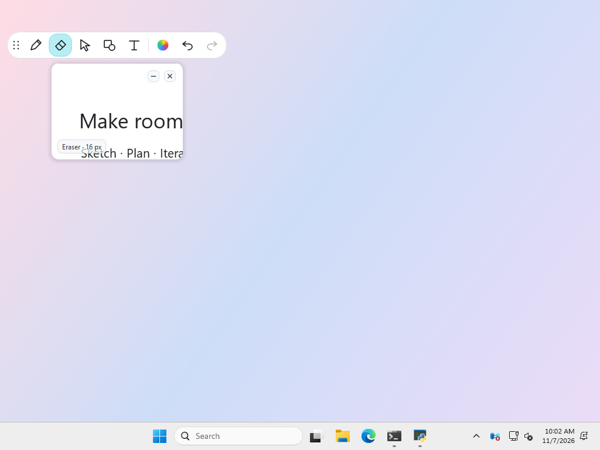

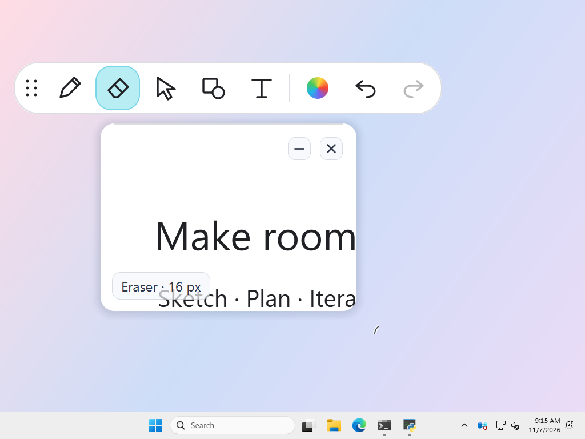

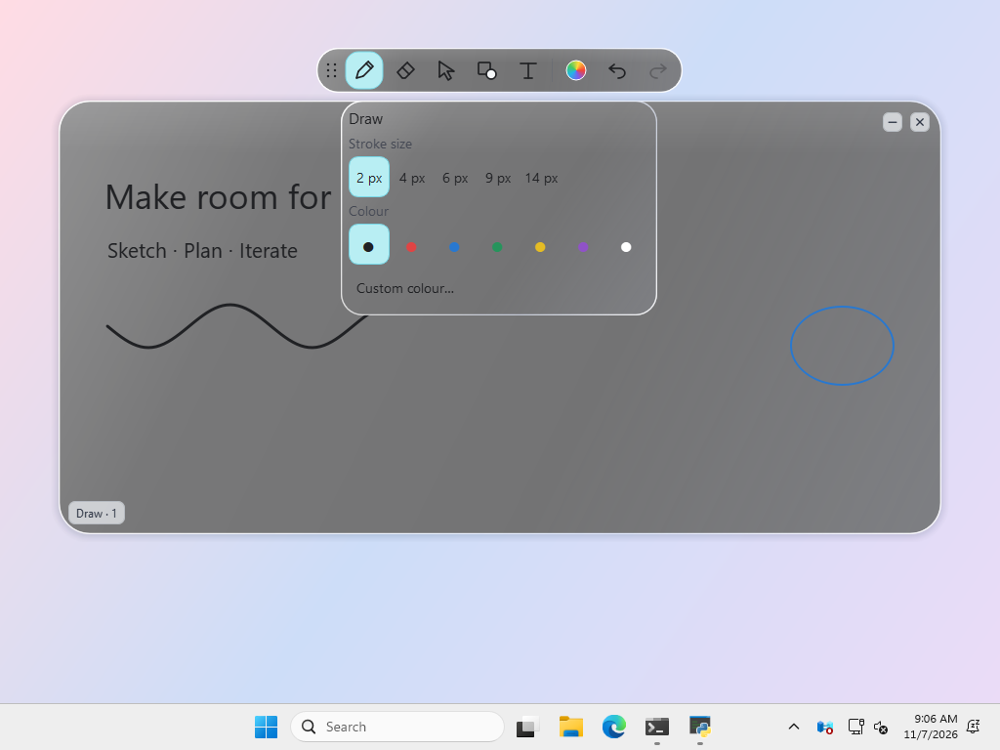

These are captures of the implemented widgets. Scale checks used Qt overrides
at 100/125/150/175/200%; physical mixed-DPI and real pen acceptance are **NOT RUN**.
Glass appeared as solid grey on both the Server VM and the Windows 11 ARM
client VM. The actual frozen-client captures below show the unresolved appearance;
Glass visual acceptance has not passed. These are diagnostic captures, not the
intended translucent result. A controlled comparison also reproduces the same
grey board in published V1.3.4 HotkeyPatch on that client. White remains the
verified opaque appearance; native Windows x64 hardware comparison is not yet run.

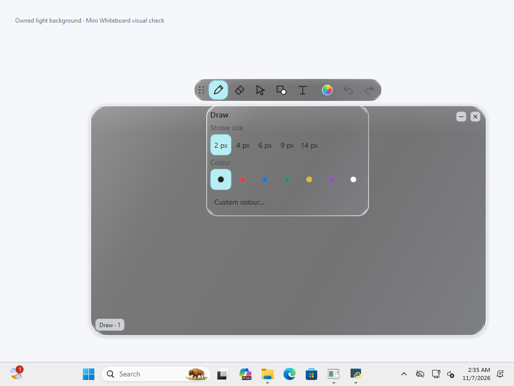

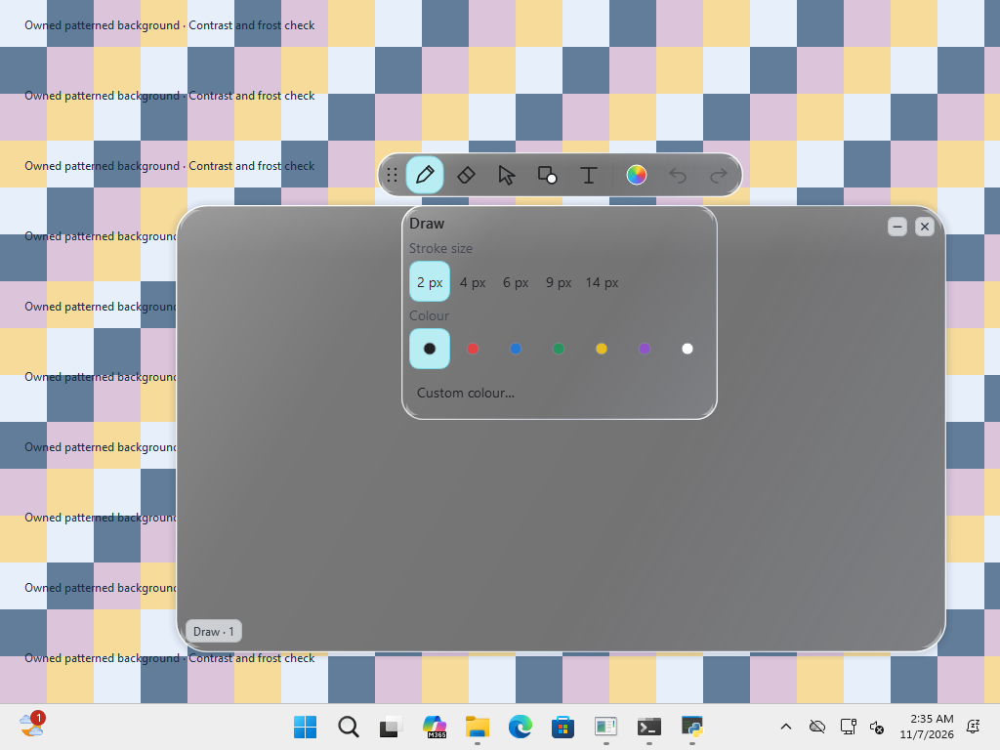

### Drawing performance

A controlled 1,920-point stroke on an empty White board reduced p95 paint work
from **12.50 ms to 0.72 ms**, with floating tools enabled. The matched 18-case
synthetic workload covered both themes, empty/populated/screenshot boards,
three stroke lengths and repeated drawing/whole-stroke erasing/undo/redo.
These are offscreen processing measurements of the unchanged review-01 drawing
code, not pen latency or display FPS. Release-and-paint cost in that matched case
rose from **6.07 ms to 12.49 ms**, and boundary clipping remains expensive.
The friend's several-second freeze has not been conclusively reproduced. See
[measurement scope, package results and remaining limits](docs/RELEASE_NOTES.md#v136--early-tester-prerelease--8-november-2026).

## Tools and shortcuts

Tools work only in the focused canvas. New boards start in Draw mode.
Press **F1** for the compact shortcut reference.

| Key | Action |
|---|---|
| D, then 1–5 | Draw at 2, 4, 6, 9 or 14 logical px |
| T, then 1–3 | Text at 14, 20 or 28 pt; apply to selected text or the next textbox |
| S, then 1–7 | Rectangle, rounded rectangle, ellipse, line, arrow, triangle, diamond |
| A or V | Select and transform; Shift-click toggles, Shift-marquee adds fully enclosed objects |
| E, then 1–4 | Partial circular eraser at 8, 16, 32 or 64 logical px |
| E, then 5 | Toggle whole-stroke erasing; toggling off returns to circular 16 px |
| C | Temporary colour palette; 1–7 choose presets |
| Arrows / Shift+arrows | Move selection by 1 / 10 logical px |
| Delete / Backspace | Delete selected editable objects |
| Escape | Cancel a gesture or clear selection |

| Action | Windows | Mac |
|---|---|---|
| Copy / cut / paste / duplicate | Ctrl+C / X / V / D | Command+C / X / V / D |
| Select all | Ctrl+A | Command+A |
| Undo / redo | Ctrl+Z / Ctrl+Shift+Z or Ctrl+Y | Command+Z / Command+Shift+Z |
| Bypass snapping | Alt | Option |
| Finish text | Ctrl+Enter or Escape | Command+Return or Escape |

Text wraps to a stored width. Enter adds a newline; the temporary editor follows
the caret for tall content. Resizing the board preserves objects and text width.
While editing, letters, numbers, clipboard commands, arrows, deletion and undo
belong exclusively to the text editor.

Clicking outside **any** active textbox finishes editing and deselects it. That
click cannot start another editor, transform or drawing action. A separate next
click can create or edit text. Meaningful text keeps its whitespace; blank new
drafts disappear without history. Clearing existing text is one undoable deletion.

Selection has shared move, resize and rotation controls. Corners preserve ratio;
edges scale one axis unless Shift is held or the group contains text or images.
Shift snaps rotation to 15°. Shape creation retains square/circle constraints.
Circular erasure cuts every editable object under its swept brush. Whole-stroke
erasure removes an original freehand gesture, including its surviving fragments.
Masks follow objects through transforms and edits.

Direct selection prioritises visible content in stacking order. A textbox's
unused wrapping width cannot cover a neighbouring note's hit area. Clicking and
dragging another object selects and moves it even inside the current selection box.

Right-click for ordering and lock/unlock commands. Paste images or drop local
PNG, JPEG and WEBP files. **Snap & Guides** controls Smart Guides and Grid Snap.
The minus button hides a board while preserving contents and history; the red
× deletes that board. The tray/menu restores boards. Closing the last board
leaves the utility running; choose **Exit/Quit Mini Whiteboard** to end the session.

## Appearance and Hide All

The glass review build adds three saved choices under **Appearance**. White is the
fresh-install default. Choosing Liquid Glass or Frosted Glass updates open boards
and floating tools immediately. The former Glass preference opens as Frosted Glass.

On macOS 26, Liquid Glass uses AppKit to refract the desktop near the rounded
rim. Frosted Glass uses an evenly diffused backdrop. Earlier supported Mac
versions use Frosted Glass for either glass choice. Mac remains a Universal2
Preview for macOS 14 and later. The system draws native Mac menus.

On Windows, both glass choices request Frosted Glass on compatible Windows 11
displays. Windows 10, remote sessions, the tested Hyper-V display driver and
systems with transparency disabled show an opaque surface. The Appearance menu
names the active fallback. Your preference survives changes to display or
accessibility settings.

Floating tools stay optional under **Settings → Show floating tools**. From a
focused canvas, **F6** focuses the toolbar, **Tab** moves between tools, **Down**
opens tool options and **Escape** returns to drawing. Reduced motion disables the
110 ms edge emphasis. A screenshot board keeps its original image and clipping
in every finish. The theme uses the native compositor without screen recording.

V1.3.1: actual Windows Glass and Appearance menu

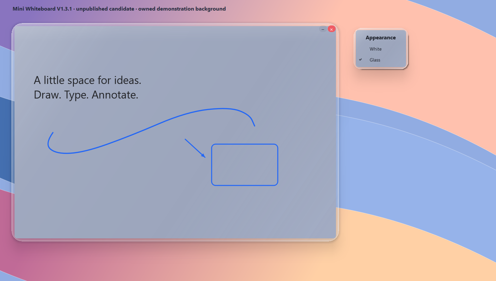

This is a native Windows capture. The caption and backdrop belong to the test
window. This older capture predates the optional floating tools.

**Ctrl+Alt+H** on Windows, **Control+Option+H** on Mac, or the matching menu action
hides all visible boards immediately. Press again to restore that recorded set
without taking focus from your current app. Already minimized boards stay hidden.
New boards remain visible outside an older hidden batch. Individually restored
or deleted boards leave the batch; a later manual minimize is respected. Held shortcut
repeats and key release cannot toggle again. Mac's alternate preset includes H;
normal Command+H remains a system shortcut.

On Windows, **Hide All shortcut** in the tray menu offers **Ctrl+Alt+H** and
**Ctrl+Alt+Shift+H**. Your explicit choice is saved for the next launch. Settings → Hotkeys also supports a custom Hide All chord. A conflict leaves
other registered actions working; choose another chord or retry.
The app never silently switches shortcuts. Mac retains its existing W/S/H presets.

OCR and Extract Text are removed in V1.3.1, including their engine and language data.
Historical V1.3 release assets and notes remain available.

## Limitations and development

- Documents are session-only. Only preferences are saved.
- V1.3.6 has completed Server checks and partial Windows 11 ARM64 client checks
  under x64 emulation. Native Windows 11 x64 and Windows 10 client acceptance,
  physical mixed-DPI/multiple-monitor setups, real pen and hardware latency are **NOT RUN**.
- School-managed policy and Smart App Control On acceptance are **NOT RUN**.
  The original reported quarantine remains unresolved; do not bypass a managed-device policy.
- Mac remains a preview. Interactive shortcuts, focus, permissions, capture,
  Spaces and Retina/multi-monitor acceptance are outstanding. Floating windows
  use normal Space membership; coverage over every full-screen app is not guaranteed.
- Linux is unsupported. Images are limited to 64 million pixels and editable
  clipboard data to 96 MB. Protected desktop content may be unavailable to capture.
- The app has no accounts, network service or telemetry.

[CONTRIBUTING](CONTRIBUTING.md) covers source setup, architecture and rebuilding.
[Testing and troubleshooting](docs/TESTING.md) covers native checks and remaining
hardware acceptance. [Report a bug](https://github.com/nottbradd/MiniWhiteboard/issues)
with the version, OS and reproduction steps.

## License

Copyright (c) 2026 nottbradd.

The current Mini Whiteboard source, documentation and original assets use the
[GNU General Public License, version 3 only](LICENSE) (`GPL-3.0-only`). This change
took effect on 16 November 2026. The software is provided without warranty; see
the license for its terms and conditions.

**Published V1.3.6 and earlier downloads and tags retain their
[MIT license](https://github.com/nottbradd/MiniWhiteboard/blob/v1.3.6/LICENSE).**
The change does not revoke the rights already granted for those versions. No
published package was rebuilt or replaced for this license change.

Dependencies retain their own terms; see [third-party notices](docs/THIRD_PARTY_NOTICES.md).
Packages contain the applicable project license, dependency notices, exact dependency
versions and notice hashes, with the [source/rebuild guide](assets/licenses/SOURCES.md).
