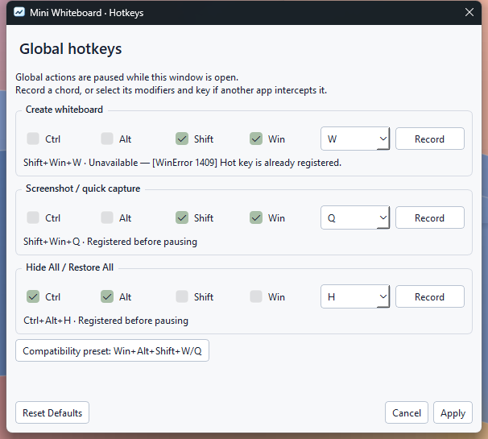
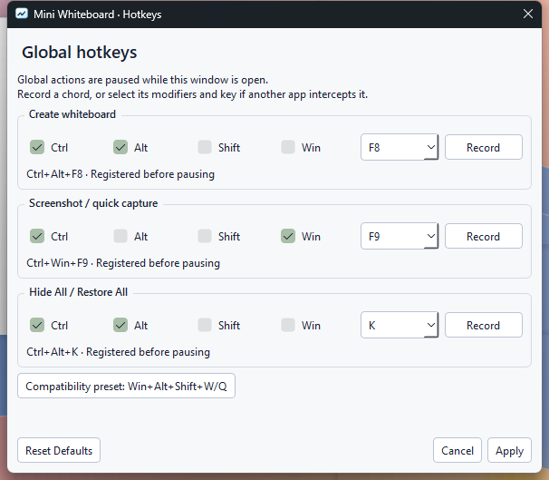

# Release notes

## V1.3.4

Published [29 October 2026](https://github.com/nottbradd/MiniWhiteboard/releases/tag/v1.3.4).
Windows installer recommended; portable ZIP also available. Mac remains
**Universal2 Preview**, macOS 14+.

- Windows defaults are **Shift+Win+W** for a blank board and **Shift+Win+Q** for
  capture. Hold, move the pointer, then release the trigger or any required modifier.
  The existing Hide All choice and Mac defaults/alternate preset are retained.
- **Settings → Hotkeys** records or manually selects independent create, capture
  and Hide All chords. Apply validates and registers before saving; failed changes
  restore working bindings and identify the failure. Cancel preserves the previous
  configuration. Reset Defaults edits the fields until Apply is chosen.
  Global actions pause while the dialog is open. An explicit Windows compatibility
  preset offers the released **Win+Alt+Shift+W/Q** pair.
- Conflicts leave other actions working and provide access to Settings. Menus,
  help and status follow the configured chords. Windows-reserved Ctrl+Esc and
  Ctrl+Shift+Esc are not overridden; unavailable cancellation chords are reported,
  with tray-menu cancellation available.
- Running the newer Windows installer replaces the existing installation under
  the same identity. Setup verifies a staged replacement and backs up replaced
  files before copying. Obsolete files are removed only when validated ownership
  and original hashes match. Preferences, custom hotkeys, startup choices and
  unrelated files survive. Setup/uninstall still require the app to be closed.
- For portable updates, close the old copy and replace its whole application
  folder. On Mac, quit and replace the app in Applications. The README downloads,
  demo and settings screenshots now show the current release.

### Verification

All three application packages use source
[`7c12b7f`](https://github.com/nottbradd/MiniWhiteboard/commit/7c12b7f09e39db2fc374ef0fe99d0e60b4507136).
[Windows CI](https://github.com/nottbradd/MiniWhiteboard/actions/runs/40827316634)
and [Mac CI](https://github.com/nottbradd/MiniWhiteboard/actions/runs/40827319930)
passed. Later documentation, demo generation and diagnostic-label changes do not
alter the verified application packages.

| Check | Actual result |
|---|---|
| Complete automated suite | 321 discovered. Local Windows and Windows CI: 319 passed, two Mac-only skips. Mac: all 321 passed twice |
| Default Windows shortcuts | Shift+Win+W returned native registration error 1409 locally and in Windows CI. Positive default-W creation is **NOT RUN (not tested)**. Shift+Win+Q capture passed; 171 final-executable default-profile checks cover the available action and conflict reporting |
| Custom shortcuts and recovery | Real Settings recording/manual selection applied Ctrl+Alt+F8 creation, Ctrl+Win+F9 capture and Ctrl+Alt+K Hide/Restore. Blank-board creation after the default conflict, capture and repeated-key-safe Hide/Restore passed. The separate custom creation matrix passed 337 checks locally and in CI |
| Compatibility and gesture cleanup | 572 source and 873 final-executable checks passed locally and in CI. Left/right modifiers, modifier-release order, repeats, Escape, rapid consecutive gestures and zero-area cancellation passed. External text/menu state remained unchanged; no unexpected foreground activation or stuck previews/keys |
| Selection, text and appearance | 41 pointer, 24 textbox, 15 appearance, 49 material and 177 surface checks passed. Final executable: 36 general plus 99 per White/Glass theme, including wrapping/completion, undo/redo, controls, clean screenshot/clipboard pixels and corner click-through |
| Lifecycle and installation | 111 general checks and 63 for each saved Hide All choice passed. Installer: 46 checks covering a real V1.3.3 upgrade, repeated setup, running-app refusal, pre-copy failure, mid-copy rollback and a launch of the restored old runtime. Obsolete owned files were removed; modified/unrelated files, hotkeys and startup-disable state survived. Portable: nine checks passed |
| Package integrity | Windows: 201 runtime files including the payload manifest, 162 frozen modules and 18 notice files. Mac: Universal2, macOS 14 minimum, 825 bundle checks before and after extraction, 16 notice files, 404 ZIP entries and eight-second Cocoa startup. Metadata, CRCs, file hashes, dependency notices and OCR absence passed |
| Supporting checks | Dependency consistency, compilation, workflow lint and local documentation references passed. The Mac ZIP is transferred unchanged; SHA-256 values and the verification receipt accompany the release |

The general native check separately records unavailable default-W registration.
The default is retained as requested; no automatic compatibility fallback or OS
shortcut takeover occurs. Current Windows checks used build 26200 x64 and one
1920 × 1080 display at 100% physical scaling. Unchanged rendering/selection code
retains prior 125–200% application-scale and performance evidence; these are not
physical mixed-DPI checks.

Installer acceptance used silent setup and the production startup service.
Unchanged wizard/startup-menu coverage is retained from V1.3.2. Temporary
preferences, links and startup registrations were restored. Packaged tray-menu
access used the real Qt notification callback, not a physical taskbar-icon click.
Capture-service failure was injected in the source check only; the released
executable contains no test-only capture-failure switch.

Final hotkey settings and conflict recovery

### Acceptance limits

**Automatic launch during actual Windows sign-in: NOT RUN (not tested).**
Startup registration, controlled command launches, external-disable preservation
and manual/login overlap were tested. The existing release-gate waiver remains.

**Other NOT RUN checks:** positive Shift+Win+W creation where registration is
blocked; interactive Mac appearance, menu-bar/global shortcuts, capture permissions,
login registration/approval and real login; macOS 14 and Intel execution; Spaces,
Mission Control, Stage Manager and physical Retina/multi-monitor acceptance.
Windows clean-machine execution with Python uninstalled, Windows 10,
quarantined-download/SmartScreen acceptance, physical negative-coordinate and
mixed-DPI transitions, actual OS high-contrast/reduced-transparency transitions,
extended IME/RTL and long-session ergonomics remain untested.

Windows is unsigned. Mac is ad-hoc signed and not notarized. CI bundle validation
and limited startup do not establish interactive Mac acceptance.

## V1.3.3

Published [29 October 2026](https://github.com/nottbradd/MiniWhiteboard/releases/tag/v1.3.3).
Windows installer recommended; portable ZIP also available. Mac remains
**Universal2 Preview**, macOS 14+.

- Windows creation shortcuts are **Win+Alt+Shift+W** for a blank board and
  **Win+Alt+Shift+Q** for screenshot capture. Hold, move the pointer, then release.
  Either left or right Win/Alt/Shift works. Mac shortcuts and the saved Windows
  Hide All choice are unchanged. Shortcut conflicts remain visible in the tray
  with a retry action; working shortcuts stay registered.
- Window controls have 20 × 20 logical-pixel surfaces and separate 24 × 24 hit
  targets. Screenshot content reaches the rounded boundary without a white header
  or exposed backing. Cached local samples provide frost behind the controls.
- Transient feedback is smaller, wraps within small boards, remains click-through
  and respects reduced motion/transparency and high contrast.
- Visible content takes priority during selection. Text line spans replace the
  invisible full-width textbox hit area. Clicking or dragging another object
  inside the current selection frame selects and moves the intended object.
  Editor dismissal still consumes its outside click.

### Verification

All three application packages use source
[`486e18e`](https://github.com/nottbradd/MiniWhiteboard/commit/486e18e978e5ce01b32dc71b37824f5966681acd).
[Windows CI](https://github.com/nottbradd/MiniWhiteboard/actions/runs/40692363386)
and [Mac CI](https://github.com/nottbradd/MiniWhiteboard/actions/runs/40692367353)
passed. Later documentation changes do not alter the verified packages.

| Check | Actual result |
|---|---|
| Complete automated suite | 302 discovered. Local Windows and Windows CI: 300 passed, two Mac-only skips. Mac: all 302 passed twice |
| Native Windows shortcuts | 572 source checks and 873 final-executable checks passed locally and in Windows CI. Both W and Q created boards through real key input; local Game Bar remained running |
| Packaged gestures | 70 creations across left/right modifiers, every required key released first, four drag directions, held repeats and rapid consecutive releases. Escape and zero-area cancellation passed; no unexpected foreground activation, external text/menu change or stuck keys/previews |
| Selection, text and appearance | 41 pointer, 24 textbox, 15 appearance, 49 material and 177 surface checks passed. Packaged checks: 36 general plus 99 per White/Glass theme, including adjacent notes, prior selection frames, undo/redo, controls, feedback and clean clipboard pixels |
| Lifecycle and startup | 111 general checks and 63 checks for each Hide All choice passed. Installer: 33 checks, including Unicode installation, V1.3.2 upgrade, preferences, external startup disable, open-board protection and uninstall. Portable: nine checks, including launch with Python absent from PATH and controlled login overlap |
| Package integrity | Windows: 200 runtime files, 160 frozen modules, 18 notices. Mac: Universal2, macOS 14 minimum, 825 bundle checks before and after extraction, 16 notices, 404 ZIP entries and eight-second Cocoa startup. Metadata, archive CRCs, file hashes and OCR absence passed |
| Supporting checks | Dependency consistency, compilation, workflow lint and local documentation references passed. Actual native W/Q preview captures and package hashes are retained with verification evidence |

Capture-service failure was injected in the source native Q check; cleanup and
recovery through the next native gesture passed. The shipped app has no test-only
failure switch. Negative-coordinate geometry has automated coverage; physical
negative-coordinate monitors were unavailable.

Windows checks used build 26200 x64 and one 1920 × 1080 display at 100% physical
scaling. Unchanged rendering/selection code retains the previous candidate's
125–200% application-scale and performance evidence. These are not physical
mixed-DPI checks. Current installer checks used silent setup and the production
startup service; unchanged wizard/menu coverage is retained from V1.3.2.
Temporary settings, shortcuts and startup values were restored. Packaged tray
restore used the real Qt notification callback, not a physical taskbar-icon click.

### Acceptance limits

**Automatic launch during actual Windows sign-in: NOT RUN (not tested).**
Startup registration, controlled command launches, external-disable preservation
and manual/login overlap were tested. They do not establish automatic launch at
sign-in; the existing release-gate waiver remains in effect.

**Other NOT RUN checks:** interactive Mac appearance, menu-bar/global shortcuts,
capture permissions, login registration/approval and real login; macOS 14 and
Intel execution; Spaces, Mission Control, Stage Manager and physical Retina/
multi-monitor acceptance. Windows clean-machine execution with Python uninstalled,
Windows 10, quarantined-download/SmartScreen acceptance, physical negative-coordinate
and mixed-DPI transitions, actual OS high-contrast/reduced-transparency transitions,
extended IME/RTL and long-session ergonomics remain untested.

Windows is unsigned. Mac is ad-hoc signed and not notarized. Mac CI startup and
bundle validation do not establish interactive acceptance under that signature.

## V1.3.2

Published [22 October 2026](https://github.com/nottbradd/MiniWhiteboard/releases/tag/v1.3.2).
Stable Windows release with a recommended installer and a clearly labelled
Mac **Universal2 Preview** download.

- Adds a recommended per-user Windows installer with a Start menu shortcut,
  optional desktop shortcut and normal uninstall. The complete portable ZIP is
  also available. Setup and uninstall refuse to proceed while the app is running.
- Adds a glass whiteboard and pen icon throughout setup, shortcuts, the executable,
  Mac bundle and About. Tray/menu-bar symbols use a simpler matching silhouette;
  Windows follows system appearance and Mac uses a native template image.
- Adds **Open at login**, off by default, to the tray/menu-bar menu. Explicit choices
  use Windows per-user Run registration or macOS SMAppService. The menu reflects
  registration, external disables, approval requirements and errors.
  **Turn off Open at login** removes the app's registration when startup is
  disabled externally or OS approval is pending.
- Manual launches and controlled launches of the registered startup command stay
  quiet. Windows updates retain preferences
  and startup choice; uninstall removes the registration belonging to that copy.
- Smooths rounded board edges, aligns themed window controls and adds glass
  previews to both hold → move → release placement modes. Boundary artwork,
  captures and temporary text editors follow the same antialiased clip.

### Verification

All three released application packages use source
[`04d9627`](https://github.com/nottbradd/MiniWhiteboard/commit/04d962786345fe2c9bf48f892271502b0d03e198).
[Windows CI](https://github.com/nottbradd/MiniWhiteboard/actions/runs/39680288687)
and [Mac CI](https://github.com/nottbradd/MiniWhiteboard/actions/runs/39680293467)
passed for that revision. Subsequent documentation changes do not alter the packages.

| Check | Actual result |
|---|---|
| Full automated suite | 280 discovered. Local Windows and Windows CI: 278 passed plus two Mac-only skips. Mac: all 280 passed twice |
| Windows native | 111 general, 59 hotkey/focus, 24 textbox, 15 appearance and 49 material/state/motion checks passed |
| Installer | 50 checks passed: fresh non-elevated Unicode installation, all 200 runtime-file hashes, 18 notices, Start/optional desktop shortcuts, repeat/upgrade, preferences, startup choices, open-board protection and uninstall cleanup |
| Startup wording | The real packaged menu showed **Turn off Open at login**, the ordinary checkbox, OS status and settings action. The renamed action removed the owned command and externally disabled approval record. Isolated tests cover Mac pending approval and registration errors |
| Portable ZIP | Nine checks passed after extraction into a permanent Unicode path: CRC/file hashes, quiet launch with Python absent from PATH, default-off/explicit registration/removal, and manual/login duplicate launches preserving the external foreground |
| Final executable | 36 package checks and 38 supplementary native checks per theme passed; text completion/wrapping, undo/redo, Hide/Restore, placement and original screenshot pixels passed |
| Edges and input | 177 native assertions passed at each of five application scales, including delivery through transparent corners to a separate process and all four screenshot directions |
| Retained text | Three font/layout/glyph/clipboard fixtures, including 24,000 wrapped Unicode characters, matched the previous approved candidate exactly |
| Windows archive | 200 runtime files, 159 frozen modules; all CRC/file SHA-256 values and 18 notice hashes verified; consistent 1.3.2/1.3.2.0 metadata |
| Mac archive | Universal2, macOS 14 minimum, macos-15 CI; 825 bundle checks before and after extraction, 16 notices, 404 ZIP entries, eight-second Cocoa startup and normal exit passed |
| Other checks | Dependency consistency, compilation, workflow lint, local documentation references and OCR absence checks passed |

Windows checks used build 26200 x64 and one 1920 × 1080 display at 100% physical
scaling. Fractional runs changed application DPR only. The native H checks used
the saved Ctrl+Alt+Shift+H alternative because Ctrl+Alt+H is occupied on this PC.
Enabled-motion checks injected a policy in the test process. Installer and
portable tests restored their controlled registry values, shortcuts and preferences.
The upgrade fixture wrapped the preserved V1.3.1 portable bundle in a test installer.

### Acceptance limits

**Windows automatic launch during actual sign-in: NOT RUN (not tested).**
Startup registration, external-disable handling, removal, persistence, controlled
launches of the registered command and manual/login instance overlap were tested.
Those checks do not establish automatic launch during a real Windows sign-in.

**Other NOT RUN checks:** interactive Mac appearance, menu-bar icon, global
shortcuts, capture permissions, login registration/approval or real login; macOS
14 and Intel execution; Spaces, Mission Control, Stage Manager and physical
Retina/multi-monitor acceptance. Windows clean-machine execution without Python,
Windows 10, downloaded/quarantined installation, physical mixed-DPI transitions
and extended IME/RTL or long-session ergonomics are also untested.

Windows is unsigned. Mac is ad-hoc signed and not notarized; CI startup and
bundle validation do not establish interactive acceptance under that signature.

## V1.3.1

Published [21 October 2026](https://github.com/nottbradd/MiniWhiteboard/releases/tag/v1.3.1).
Stable Windows release with a clearly labelled Mac preview download.

- Glass uses one rounded native backdrop and one continuous light-catching edge.
  The smaller rectangular frosted core and parallel perimeter lines are removed.
  Matching menus have roomier rows, clearer selected/focused states and bold
  headings. White retains its established default appearance.
- F1 help groups shortcuts into two columns on larger desktops, reflows to one
  scrolling column on smaller desktops and shows the selected H binding.
- A restrained 140 ms edge light catch accompanies Glass creation, restore,
  theme changes and temporary surfaces. Repeated triggers keep the original
  deadline. Hide/close stops it; reduced motion suppresses it. Document content
  never moves, scales or fades as part of presentation.
- Removed OCR actions, workers/backends, engine/language payload and exclusive
  dependencies. Original V1.3 assets, attribution and dependency sources remain.
- Saved Windows Hide All choices remain Ctrl+Alt+H and Ctrl+Alt+Shift+H. Failed
  H registration preserves W/S. Restore All preserves the foreground application.
- Text/editor fonts, wrapping, masks, transforms, clipboard output, history,
  screenshot caching and hold → move → release placement remain unchanged.
- Queued placement activation now preserves a textbox opened immediately after
  creation. Help text is laid out when requested, avoiding that work during placement.

Mac remains a preview. Glass uses supported compositor
frost, static shading and an edge highlight; it has no optical refraction,
desktop-capture loop or native Apple Liquid Glass dependency.

### Material correction

The previous Windows host could retain stale dark-background material when a
background update and popup entry occurred together. Focus, HWND identity and
host order were unchanged; waiting over a second did not repair the displayed
pixels, while closing the popup did. A successful native-effect flag did not
establish visible correctness. The precise internal DWM cache decision is not
exposed by its API.

Windows now uses a host backdrop brush and an explicit rounded compositor clip.
The visual fills the board's bounds. One physical pixel of antialias coverage
sits under its painted rim, with matching corner centres. There is no inset
frosted rectangle, desktop readback, activation workaround or polling timer.
Unsupported systems, reduced transparency and high contrast retain solid fallbacks.

### Verification

Built from [`8d0f10a`](https://github.com/nottbradd/MiniWhiteboard/commit/8d0f10a69e9a239a12fdbf80bf561cc8690b8773)
on `codex/v1.3.1-liquid-glass`.
[Windows CI](https://github.com/nottbradd/MiniWhiteboard/actions/runs/39570524574) and
[Mac CI](https://github.com/nottbradd/MiniWhiteboard/actions/runs/39570529848) passed
for that exact source. The release tag includes subsequent documentation changes;
application code, build inputs and the approved package bytes are unchanged.

| Check | Actual result |
|---|---|
| Baseline | 237 discovered; Windows 235 passed plus two Mac-only skips |
| Final source suite | 244 discovered; Windows 242 passed plus two skips; Mac all 244 passed twice; project watchdog |
| Windows native | 112 general, 61 hotkey/focus, 22 textbox, 15 appearance/geometry and 49 material/state/motion checks |
| Final executable | 37 package checks and 17 supplementary native Glass/H/menu/help checks |
| Material | Independent owned background process; focused/unfocused comparisons, all popups, live background changes, same-turn update/popup, recreation and fallbacks passed |
| Native clipping | 244 outside-corner pixel probes at each of normal/minimum sizes showed no backdrop leakage; 244 input probes passed through; all four diagonal grips worked |
| Presentation | Native enabled frames use an injected test policy; OS motion remained disabled. Reduced motion suppressed the effect. Strict 180 ms wall-clock condition assertions, interruption and loaded-thread checks passed |
| Resources | After warmup, 30 further source menu/theme/hide cycles: GDI/User 47/60 → 47/59. Twenty frozen hide/restore cycles: 47/57 → 47/57. Hosts released, owned shadows hidden, timers stopped and normal shutdown passed |
| Windows package | 174 runtime files, 153 frozen modules; all ZIP CRC/file SHA-256 and 17 notice hashes verified; 1.3.1 strings, 1.3.1.0 numeric/manifest metadata |
| Mac builder | macOS 15.7.9 arm64, universal2 Python 3.13.15, Qt/PySide6 6.11.2, PyInstaller 6.22.3 and PyObjC 12.2.2 |
| Mac bundle/archive | Universal2, 14.0 minimum; 770 architecture/linkage/signature/symlink/module/notice checks before and after ditto extraction; 15 notices, 375 ZIP entries and metadata round-trip passed |
| Mac startup/transfer | Eight-second Cocoa launch and normal exit passed; finished Mac ZIP transferred unchanged and checked against the Mac hash |
| Retained content | Three font/layout/glyph/clipboard fixtures, including 24,000 wrapped Unicode characters, remained byte-identical; native ink stayed opaque |
| Other checks | Dependencies, compilation, workflow lint, 32 local documentation links and OCR absence checks passed |

Windows measurements and captures used build 26200 x64, Python 3.12.14,
Qt/PySide6 6.11.2 and one 1920 × 1080 display at 100%. Both saved H choices
remain available. Ctrl+Alt+H is occupied by another app on this PC; tests selected,
persisted/reloaded and natively exercised the shipped Ctrl+Alt+Shift+H alternative.
The source and final executable captures were personally inspected. Interactive
Mac acceptance is not established by CI or bundle validation.

### Performance against the previous reviewed candidate

Both preserved and revised packages ran on the same Windows machine. Startup
uses five alternating warm launches per package; these small samples vary by run.

| Measurement | Previous candidate | V1.3.1 |
|---|---:|---:|
| Median launch to tray | 399.5 ms | 411.3 ms |
| Tray working set / private memory | 56.59 / 26.66 MiB | 56.71 / 26.93 MiB |
| CPU time in separate 60-second tray-idle samples | 0.0 s | 0.0 s |
| Visible Glass blank-board working set / private memory | 79.85 / 35.59 MiB | 80.15 / 35.07 MiB |
| Native dot-to-observed-pixel median, Glass blank | 38.93 ms | 39.71 ms |
| Native dot-to-observed-pixel median, Glass screenshot | 37.39 ms | 38.09 ms |
| White processing median of medians / worst p95 | 1.89 / 5.01 ms | 1.87 / 5.41 ms |
| Glass processing median of medians / worst p95 | 1.87 / 5.29 ms | 1.58 / 4.91 ms |
| Wrapped-text hit path median / p95 | 0.049 / 0.108 ms | 0.048 / 0.089 ms |

Native latency uses 16 dots per case and includes input delivery, compositor
and GDI observation. Control runs observed every dot in the first capture;
capture-only medians were 21–26 ms. Repeated Glass blank medians were 44.00 /
44.89 ms, with p95 51.00 / 48.35 ms. The screenshot repeat was 44.31 / 44.27 ms.
These measurements do not isolate display latency or establish a universal speedup.

Source measurements use 28 workloads with 120 events each, 20 strokes, 20 shapes,
10 text objects and blank/1080p/1440p/4K backgrounds. The preserved source was
repeated in the same dependency environment. Initial White/Glass medians were
1.82 / 2.14 ms; the table uses the matched repeat. Individual timings varied:
White 1080p marquee median was 0.71 → 0.93 ms. Every screenshot cache built once;
source-image paint/decode work stayed zero. The long-text geometry and pixel
fixtures were unchanged. Detailed samples remain in local verification evidence.

### Downloads

The approved Windows archive and the Mac-created preview archive are published
unchanged. [Checksums, dependency notices and exact dependency sources](https://github.com/nottbradd/MiniWhiteboard/releases/tag/v1.3.1)
accompany the downloads.

| Package | Bytes | SHA-256 |
|---|---:|---|
| [WinMiniWhiteboardV1.3.1.zip](https://github.com/nottbradd/MiniWhiteboard/releases/download/v1.3.1/WinMiniWhiteboardV1.3.1.zip) | 37,822,209 | `9cbebd8f864430637e659c47a76227c988ef9d3c75fb6e5e285dc7d55c466b60` |
| [MacMiniWhiteboardV1.3.1-Preview.zip](https://github.com/nottbradd/MiniWhiteboard/releases/download/v1.3.1/MacMiniWhiteboardV1.3.1-Preview.zip) | 56,452,627 | `caefb39d524e3102685209fcdf7c016ffaa4f35e28c5d74fa48c2972df33c392` |

Windows is unsigned. Mac is ad-hoc signed and not notarized.

**NOT RUN:** interactive Mac appearance/shortcuts/focus, permission/capture flows,
Spaces, Retina and physical multi-monitor acceptance; macOS 14 and Intel execution;
Windows 10, clean-machine deployment, physical mixed-DPI arrangements and extended
hand-operated IME/RTL/handle ergonomics. Mac native animation/performance were not
measured.

## V1.3

Published [21 October 2026](https://github.com/nottbradd/MiniWhiteboard/releases/tag/v1.3).

- Every outside textbox click now finishes editing and deselects it. The same
  press/release/double-click cannot start another editor or tool action. A separate
  click can create/edit text. Blank drafts preserve history/redo; clearing existing
  text remains one deletion. Keyboard finish retains useful selection/presets.
- Added global saved **White / Glass** appearance. Windows 11 22621+ uses native
  DWM Acrylic behind the artwork; Mac uses NSVisualEffectView. Unsupported effects,
  reduced transparency and high contrast use a solid readable fallback. Artwork,
  original image pixels, masks, geometry and clipboard output remain unchanged.
- Brief 140 ms top-edge emphasis and feedback fades respect reduced motion.
  Hide is immediate. No animated backgrounds, idle repaint or desktop-capture loop.
- Added offline **Extract Text…** for existing images, including locked screenshots.
  Review/correct, then explicitly Copy or Insert as wrapped text. Insertion is one
  undo action. Windows bundles Tesseract 5.5.3 and English data; Mac uses Vision.
  English is the guaranteed language. OCR is fallible and never automatically
  changes clipboard or document. Original-resolution input is rectified from display
  transforms, masked/clipped, composited on white and normalized for dark backgrounds.
- Added **Ctrl+Alt+H** / **Control+Option+H** Hide All / Restore All. Only the visible
  recorded batch returns; manually minimized, individually restored/deleted and new
  boards follow the rules in README. Restore preserves the foreground application.
  Conflict warnings are nonblocking and retain working W/S bindings.
- OCR has one process plus one queued request across the app, a 20-second timeout,
  16-million-pixel/32-MiB input and 100,000-character output limits. Hide/close,
  source changes and cancellation invalidate results and stop owned worker processes.

### Release verification

Release source: [`60e8f15`](https://github.com/nottbradd/MiniWhiteboard/commit/60e8f1534aef4870d3694482cc9f4d6032d1ed59).
[Windows CI](https://github.com/nottbradd/MiniWhiteboard/actions/runs/39551606504) and
[Mac CI](https://github.com/nottbradd/MiniWhiteboard/actions/runs/39551606590) passed for that source.

| Check | Actual result |
|---|---|
| Windows automated suite | 236 discovered; 234 passed, two Mac-only symlink skips |
| Mac automated suite | All 236 passed, repeated before packaging |
| Windows desktop checks | 112 general checks, 20 native text checks, 60 hotkey/focus checks with the H conflict/test-chord limitation below; 9 native Glass/OCR/resource checks |
| Final Windows executable | 35 packaged checks plus exact clean/dark/transparent OCR; restricted PATH, invalid external data path, Unicode/space paths and Python socket audit guard |
| Windows ZIP | 219 runtime files, every CRC/file SHA-256 checked; 35 notice hashes; strings 1.3, numeric/manifest 1.3.0.0 |
| Mac runner | macOS 15.7.9 arm64; Python 3.13.15, Qt/PySide6 6.11.2, PyInstaller 6.22.3, PyObjC 12.2.2 |
| Mac bundle | Universal2, 14.0 minimum; 829 architecture/linkage/signature/symlink/notice checks before packaging and after ditto extraction; 32 notice hashes |
| Mac startup and OCR | Limited startup passed; source and frozen Vision matched all three clean/dark/transparent fixtures exactly |
| Mac ZIP | 402 entries; CRC, metadata roundtrip and complete extracted-app revalidation passed; transferred unchanged from Mac |
| Other checks | Source compilation, dependencies, workflow lint and local documentation links passed |

Windows measurements used Windows 11 build 26200 x64, Python 3.12.14 and
Qt/PySide6 6.11.2. Compared with the preserved V1.2.1 package on the same machine:

| Measurement | V1.2.1 | V1.3 |
|---|---:|---:|
| Median warm startup to tray, five samples | 275.6 ms | 282.9 ms |
| Median working set | 53.2 MiB | 56.8 MiB |
| Median private memory | 25.3 MiB | 27.6 MiB |
| CPU time in a 60-second idle sample | 0.0 s | 0.0 s |
| Median of 28 event-latency medians | 1.303 ms | 1.252 ms |
| Worst event p95 across those cases | 4.586 ms | 2.974 ms |
| Windows ZIP size | 37,783,789 bytes | 44,755,989 bytes |

The annotation fixture uses 20 strokes, 20 shapes and 10 text objects on blank,
1080p, 1440p and 4K backgrounds (120 samples per case). Each screenshot cache
built once; source decode/image-paint counters stayed zero during annotation.
These are processing timings, not display FPS. A 24,400-character wrapped textbox
had a 0.046 ms median / 0.063 ms p95 hit path. Six real OCR jobs left GDI/user counts,
history and clipboard unchanged (971 ms median including review-window lifecycle).
A noisy 24.9 MB 4K input cancelled cleanly; maximum GUI heartbeat gap was 77.7 ms.
Thirty native theme/hide cycles returned to unchanged GDI/user counts.

### Downloads

| Package | Bytes | SHA-256 |
|---|---:|---|
| [WinMiniWhiteboardV1.3.zip](https://github.com/nottbradd/MiniWhiteboard/releases/download/v1.3/WinMiniWhiteboardV1.3.zip) | 44,755,989 | `15e870dca619f25f198b5cde4b3dcaa44be0b369da1d4918bf03c4b137a226ff` |
| [MacMiniWhiteboardV1.3-Preview.zip](https://github.com/nottbradd/MiniWhiteboard/releases/download/v1.3/MacMiniWhiteboardV1.3-Preview.zip) | 56,918,634 | `aa559058e7d1ed68b2239a57f7975c5202a59bb0ddf1e05dbfae057b27c5d9c9` |

[Checksums](https://github.com/nottbradd/MiniWhiteboard/releases/download/v1.3/SHA256SUMS.txt), dependency notices and exact dependency sources accompany the [V1.3 release](https://github.com/nottbradd/MiniWhiteboard/releases/tag/v1.3). The Mac preview is ad-hoc signed, not notarized; Windows is unsigned.

### Limitations and checks not run

On this machine another application already owns Ctrl+Alt+H (Windows error 1409).
The actual default conflict path preserves W/S. Native H dispatch, held repeats,
release orders and external-focus restore passed using a temporary
Ctrl+Alt+Shift+H test binding; the shipped Windows binding remains Ctrl+Alt+H.
The original failed default-binding test is retained in local verification records.

Mac remains a preview. Interactive Glass, native shortcuts/focus, Screen Recording
permissions, Spaces, Retina and physical multi-monitor behaviour remain **NOT RUN**.
Execution on macOS 14 and Intel hardware, Windows 10, clean-machine disconnected
operation and physical mixed-DPI testing are also **NOT RUN**. Restricted-path OCR
checks with a Python network audit guard are separate from clean-machine testing.

## V1.2.1

Windows bug-fix release with a clearly labelled macOS 14+ preview.

### Changes

- Clicking outside a blank or whitespace-only textbox dismisses it without
  creating a replacement or starting a canvas action. A separate next click
  immediately creates text. Discarding a draft preserves undo/redo.
- Clearing existing text removes that object in one undoable operation.
  Undo restores content, width, transforms, masks, colour and stacking.
- Old editor callbacks cannot finish a newer session. Double-click dismissal
  follows the same ownership rule. Meaningful Text-mode continuation remains
  available with one click and cannot activate a transform handle.
- Transformed editor context menus retain their editing session while open;
  deferred focus callbacks recognize menus embedded in the proxy scene, and
  outside menu dismissal restores editor focus.
- Dismissing the colour palette no longer replays a click into a canvas tool.
- Escape detection resets for a fresh global creation hold after idle.
- Repository documentation is consolidated into usage, contribution, release,
  testing and dependency guides. Historical releases remain available below.

### Verification

Release source: [e1d976c5c2ea389fe6b339f15d88442bd34815fe](https://github.com/nottbradd/MiniWhiteboard/commit/e1d976c5c2ea389fe6b339f15d88442bd34815fe).
Published [20 October 2026](https://github.com/nottbradd/MiniWhiteboard/releases/tag/v1.2.1).

The loop was reproduced with native Windows input: the outside press finished
the editor and then reached the active Text tool. The patch gives that press one
owner. Additional reproduced fixes cover whitespace/history, invisible cleared
text, stale sessions, unintended drawing/transforms, embedded menu lifetime/focus,
palette click replay and Escape rearming after idle.

| Check | Actual result |
|---|---|
| Windows build gate | 213 discovered: 211 passed, two Mac-only skips, 6.343 s; Windows 11 build 26200, Python 3.12.14 x64 |
| Windows native regressions | 111 GUI/controller checks; 49 external-focus W/S checks; 18 native textbox checks; eight supplementary assertions for clicks in an owned separate application |
| Final Windows executable | 34 packaged checks, including native blank dismissal, continued typing, deletion/undo/redo and palette dismissal |
| Windows ZIP/notices | 174 files, every CRC/file SHA-256 verified; 17 notice hashes; strings 1.2.1, numeric/manifest 1.2.1.0 |
| [Windows CI](https://github.com/nottbradd/MiniWhiteboard/actions/runs/39388714120) | 211 passed, two skips, 6.771 s; Windows Server 2025, Python 3.12.10 x64 |
| [Mac CI](https://github.com/nottbradd/MiniWhiteboard/actions/runs/39388714069) | 213 passed, 13.697 s; repeated before build, 8.579 s |
| Mac builder | macOS 15.7.9 arm64; Universal2 Python 3.13.15; Qt/PySide6 6.11.2, PyInstaller 6.22.3, PyObjC 12.2.2 |
| Mac bundle/startup | Universal2, 769 checks; eight-second Cocoa startup/normal exit 0; deployment/runtime/plist minimum 14.0 |
| Mac ZIP/notices | 375 entries; ditto extraction plus full file/mode/symlink/bundle revalidation; 15 notice hashes; Mac-created ZIP transferred unchanged |
| Other checks | 28 screenshot workloads retain cache invariants; workflow lint, compilation, dependencies and 31 documentation/source-archive links passed |
| Publication | Nine uploaded asset digests match; all public asset links and tagged demo return HTTP 200; both app downloads and checksums rehashed anonymously |

Twenty-two new regressions cover visible overlay press/release, blank/whitespace
history, exact existing-text deletion/undo, rapid/double clicks, stale callbacks,
popup input, controls/other targets, transformed/panned editing and lifecycle.
Native checks used one 1920×1080 display at 100%. Screenshot timings measure
GUI-thread work; they do not certify display FPS.

**NOT RUN:** interactive Mac shortcuts/Escape, focus/menu/Spaces, Screen Recording
permission/capture and Retina/multi-monitor acceptance; macOS 14 and Intel
execution; physical mixed-DPI Windows arrangements, Windows 10/clean deployment,
hand-operated IME/RTL/emoji, handle/editor ergonomics and prolonged use.
Mac remains a preview. Universal2 inspection does not establish Intel execution.

### Downloads and SHA-256

| Package | Bytes | SHA-256 |
|---|---:|---|
| [WinMiniWhiteboardV1.2.1.zip](https://github.com/nottbradd/MiniWhiteboard/releases/download/v1.2.1/WinMiniWhiteboardV1.2.1.zip) | 37,783,789 | `7e876fe8786596fe9d95072ce2111bb88a4f96330e9750541ac4316ebbce5f55` |
| [MacMiniWhiteboardV1.2.1-Preview.zip](https://github.com/nottbradd/MiniWhiteboard/releases/download/v1.2.1/MacMiniWhiteboardV1.2.1-Preview.zip) | 56,427,689 | `54b8fe6f2db52bfc1938679fbdc26539a454888f7963d5d43d165c63ab9bc1cb` |

[Checksums](https://github.com/nottbradd/MiniWhiteboard/releases/download/v1.2.1/SHA256SUMS.txt)
cover both apps, the separate notice ZIP and five exact dependency source archives.
Both apps retain license texts and source/rebuild information. Earlier assets and
repository visibility are unchanged.

[Testing guide](TESTING.md) · [Dependency notices](THIRD_PARTY_NOTICES.md)

## Earlier releases

- [V1.2](https://github.com/nottbradd/MiniWhiteboard/releases/tag/v1.2):
  hold → move → release creation, repeat protection and naturally wrapped text.
  Windows release and Mac preview, with original verification and checksums.
- [V1.1](https://github.com/nottbradd/MiniWhiteboard/releases/tag/v1.1):
  drawing, text, shapes, group transforms, erasers, clipboard/images, colours,
  guides, locking and screenshot annotation. Windows release and Mac preview.

Those release notes, tagged source and assets retain the historical results.
